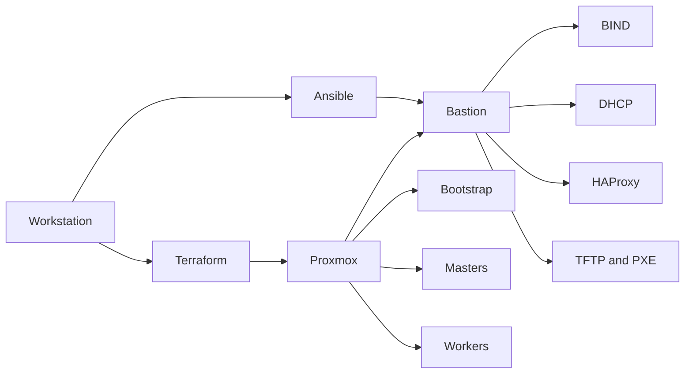

# terraform-openshift-ansible

Terraform and Ansible install OKD and OpenShift Container Platform (user-provisioned, PXE) on Proxmox.

## Tech stack

- Proxmox VE and cloud-init VM templates
- Terraform with the Telmate Proxmox provider
- Ansible (BIND, DHCP, HAProxy, TFTP/PXE)
- OpenShift `openshift-install`, OKD and OCP 4, RHCOS/Fedora CoreOS
- Optional Argo CD operator on the OCP cluster

## Architecture



Each cluster has a bastion that serves DNS, DHCP, the API and ingress load balancer, and the PXE boot files. Bootstrap, three control-plane nodes, and three workers boot from that bastion. Terraform clones the bastion from a cloud-init template and creates empty PXE guests. Ansible renders `install-config.yaml` and the service configs. `openshift-install` then waits for bootstrap and for install completion.

OKD and OCP are separate stacks so they can be brought up independently:

| Cluster | Virtual machines | Bastion services |
| --- | --- | --- |
| OKD | `1-okd-vm-terraform` | `2-okd-bastion-ansible` |
| OCP | `3-ocp-vm-terraform` | `4-ocp-bastion-ansible` |

OCP sizing in this lab: bastion 4 vCPU / 16 GB, each master 4 vCPU / 16 GB, each worker 4 vCPU / 8 GB, bootstrap 4 vCPU / 16 GB. OKD uses the same pattern on its own bridge. Change MAC addresses, VM IDs, and IP addresses in the Terraform locals before apply.

## Layout

```text
0-pve-template/          Proxmox template and bridge notes
1-okd-vm-terraform/      OKD bastion and PXE guests
2-okd-bastion-ansible/   OKD DNS, DHCP, HAProxy, PXE, install-config
3-ocp-vm-terraform/      OCP bastion and PXE guests
4-ocp-bastion-ansible/   OCP DNS, DHCP, HAProxy, PXE, install-config
env.local.example        lab usernames, passwords, API token, pull secrets
scripts/load-env-local.sh
```

The Ansible task directories configure BIND, DHCP, HAProxy, and TFTP/PXE. Variable files and Jinja templates hold cluster domain, node names, and IP addresses.

## Run

Requirements: a Proxmox host, Terraform `>= 1.1`, Ansible, an SSH key, and either an OKD release or a Red Hat pull secret for OCP.

1. Prepare the Proxmox bridges and the cloud-init template described in `0-pve-template/`.
2. Create the API token on the Proxmox host and store it in `env.local`:

```bash
cp env.local.example env.local
# fill PROXMOX_*, PFSENSE_*, kubeadmin, Argo CD, and pull-secret values
./scripts/load-env-local.sh
```

`load-env-local.sh` writes `2-okd-bastion-ansible/files/pull_secret.txt` and `4-ocp-bastion-ansible/files/pull_secret.txt`. Those files are gitignored. Until you have a real pull secret, the example file `pull_secret.txt.example` contains a fake `auths` document so the playbook syntax can be reviewed.

3. Copy the Terraform variable example and set the sensitive values from `env.local` (`cipassword`, `pm_api_token_secret`, `ssh_key`, `pm_api_url`):

```bash
cp 3-ocp-vm-terraform/terraform.tfvars.example 3-ocp-vm-terraform/terraform.tfvars
cp 1-okd-vm-terraform/terraform.tfvars.example 1-okd-vm-terraform/terraform.tfvars
```

`*.tfvars` is gitignored.

4. Create the VMs:

```bash
cd 3-ocp-vm-terraform   # or 1-okd-vm-terraform
terraform init
terraform plan
terraform apply
```

5. Configure the bastion:

```bash
cd 4-ocp-bastion-ansible
ansible-playbook playbook-services-ocp.yaml
```

For OKD, run `2-okd-bastion-ansible/playbook-services-okd.yaml`.

6. Boot bootstrap, then the control-plane nodes. On the bastion:

```bash
openshift-install --dir=install_dir/ wait-for bootstrap-complete --log-level=info
```

7. Approve pending CSRs, comment the bootstrap server out of HAProxy, shut the bootstrap VM down, and start the workers:

```bash
oc get csr -o go-template='{{range .items}}{{if not .status}}{{.metadata.name}}{{"\n"}}{{end}}{{end}}' | xargs --no-run-if-empty oc adm certificate approve
openshift-install --dir=install_dir/ wait-for install-complete --log-level=info
```

8. Log in to the console with `kubeadmin`. The password is `OKD_KUBEADMIN_PASSWORD` or `OCP_KUBEADMIN_PASSWORD` in `env.local`. Add the console, OAuth, and API hostnames to your workstation `/etc/hosts`, pointing them at the bastion address in that file.

Worker nodes often stay `NotReady` until their kubelet serving CSRs are approved. Repeat the `oc adm certificate approve` command after the first reboots. `oc get co` should show every cluster operator available before you treat the install as finished.

Argo CD, when installed from OperatorHub, keeps its admin password in a cluster Secret. Record it in `ARGOCD_ADMIN_PASSWORD` in `env.local` instead of pasting it into this README.

## What this demonstrates

- A user-provisioned OpenShift install on a homelab hypervisor
- Terraform for the bastion and the PXE guests, Ansible for DNS, DHCP, load balancing, and ignition hosting
- The same pattern applied to both OKD and Red Hat OpenShift
- Day-2 notes for CSR approval and an Argo CD operator install, without embedding lab passwords in git

## Secrets

Passwords, the Proxmox API token, kubeadmin passwords, the Argo CD admin password, and both pull secrets are in `env.local` only. That file is gitignored. `env.local.example` lists the keys with empty values.

Before publishing, confirm git is not tracking:

- `env.local`
- `**/files/pull_secret.txt`
- `*.tfvars`
- `*.log`

Pull secrets already committed in older history should be rotated in the Red Hat console. Removing them from the current tree does not remove them from past commits.

## License

`4-ocp-bastion-ansible/LICENSE` is GPL-3.0 and covers that Ansible tree. The other directories have no separate license file.
